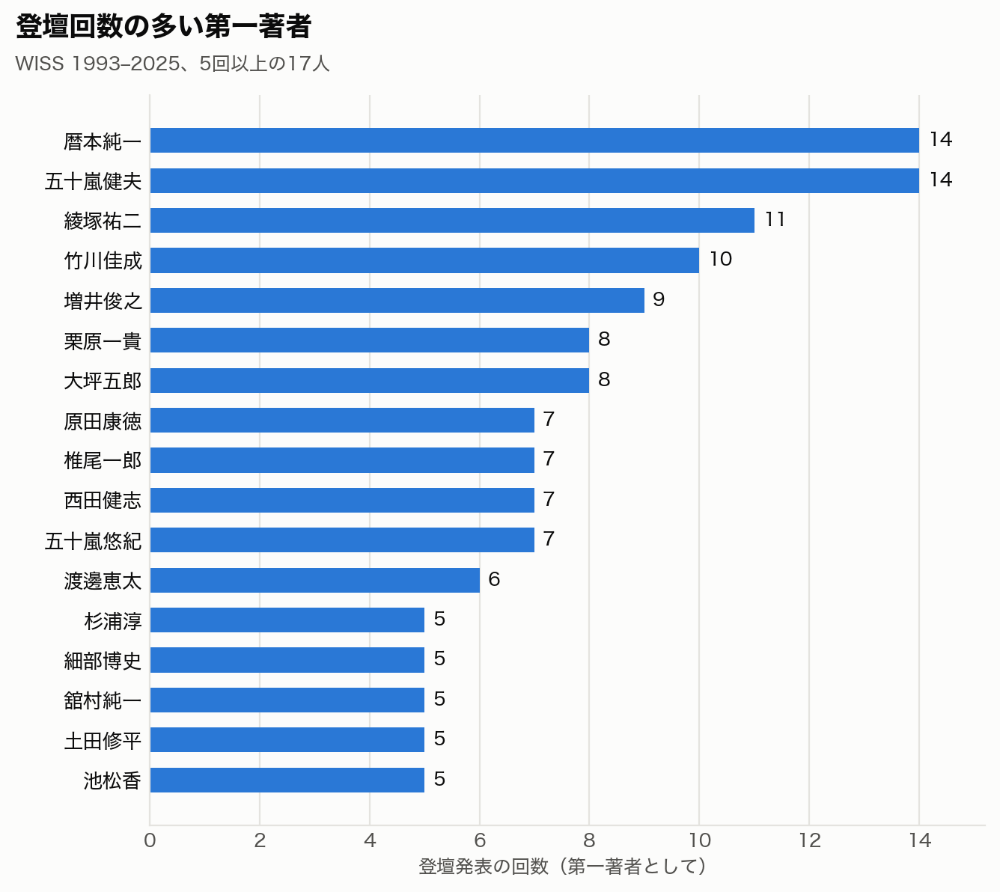
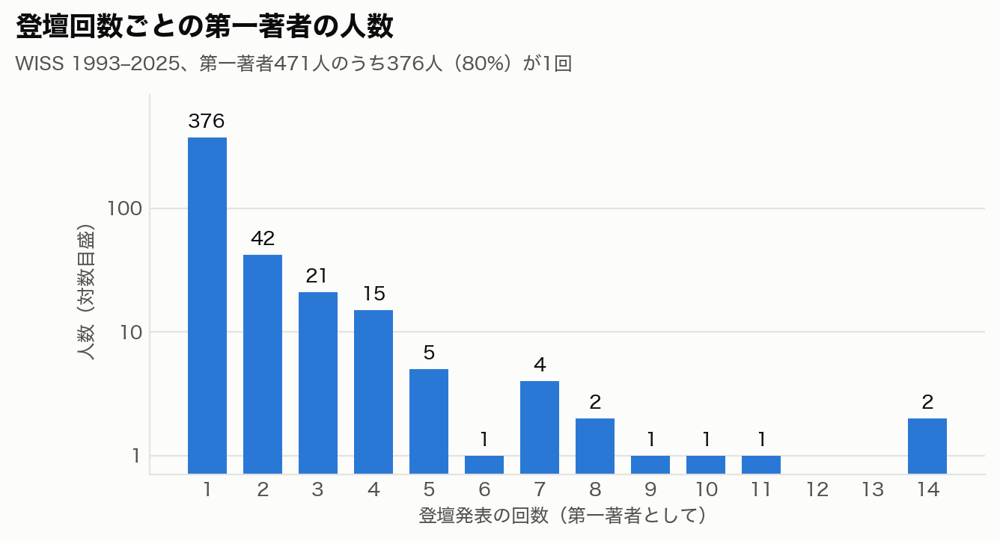
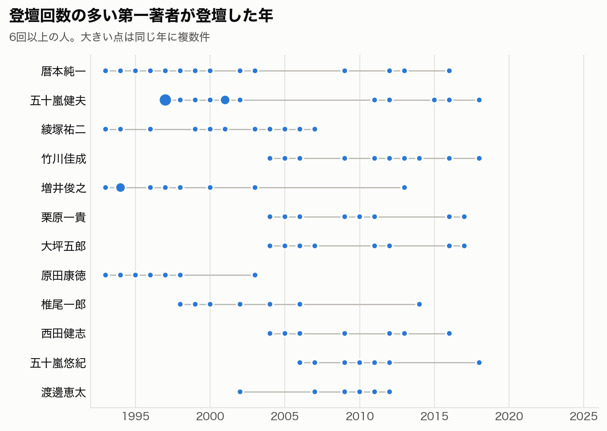
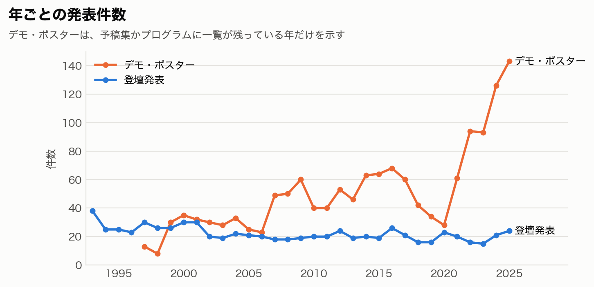
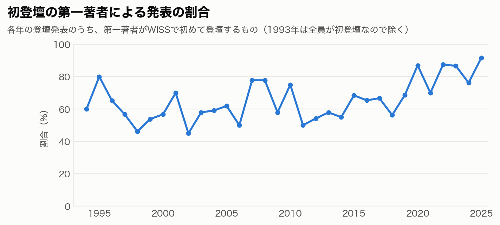
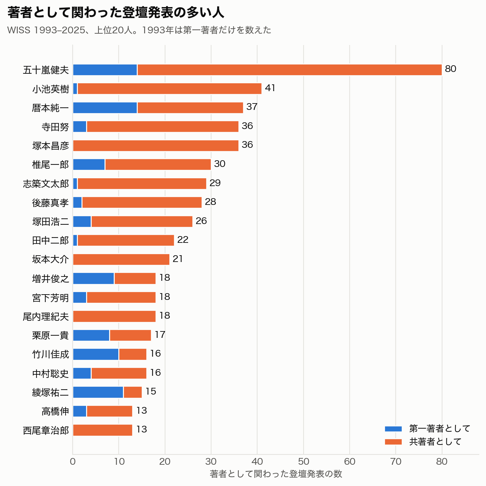
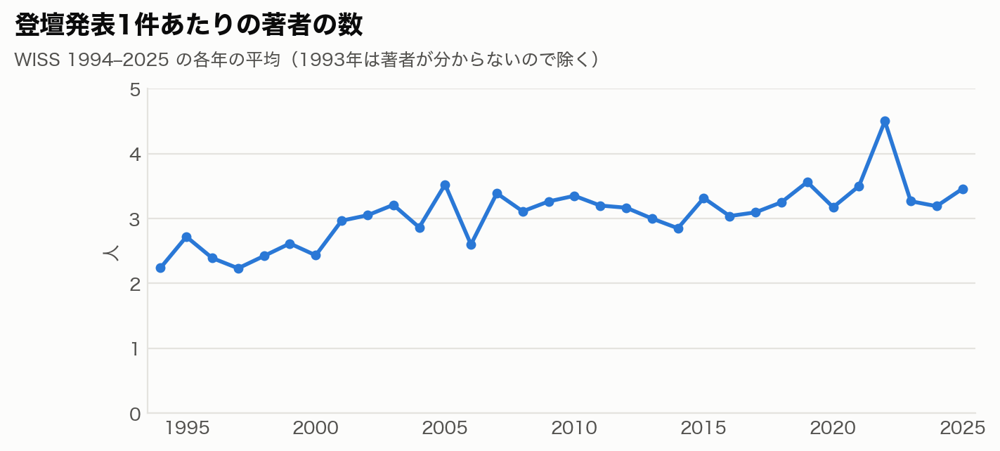
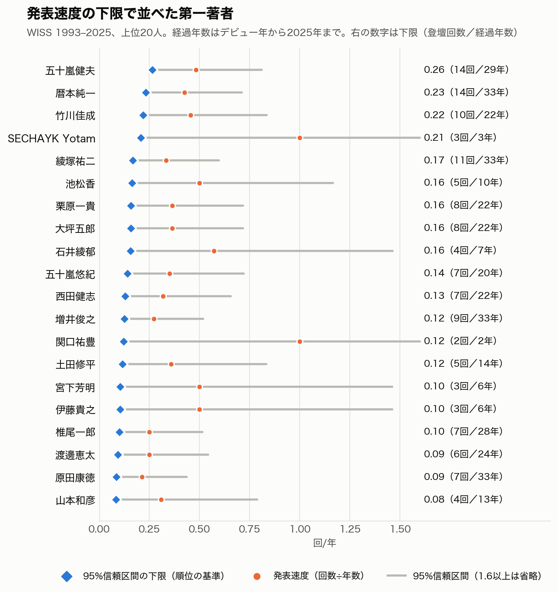
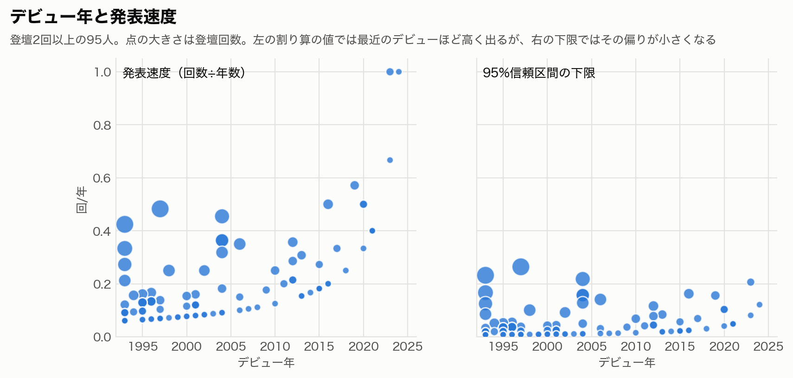
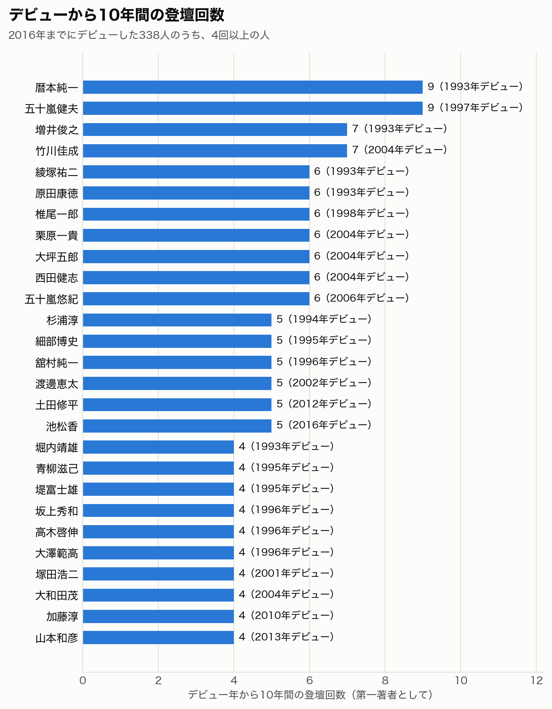

# WISS 登壇発表の第一著者の統計（1993–2025）

日本ソフトウェア科学会の「インタラクティブシステムとソフトウェアに関するワークショップ」（WISS）について、
第1回（1993年）から第33回（2025年）までの登壇発表を全件集め、第一著者ごとの登壇回数を集計した調査である。

> **暫定版である。** WISS2026（第34回）のプログラムが公開されたあとに2026年分を加え、確定版として公開する予定である。
> 図と数値は `make_figures.py` で `data/` から作り直せるので、2026年分の表を足せば確定版の図になる。

調査と集計：栗原一貴（津田塾大学）　｜　版 0.1.1（暫定版）　｜　[変更履歴](CHANGELOG.md)

- **HTML 版**：https://unryu.org/wiss-talk-stats/
- **スライド版**：https://unryu.org/wiss-talk-stats/slides.html （← → キーで移動）

## 調査の結果の概要

- 1993年から2025年までの33回で、登壇発表は **730件** あった。そのうち716件の第一著者が分かっており、第一著者は **471人** である。
- 第一著者の **80%（376人）は、登壇発表が1回だけ** である。2回以上登壇した95人の発表が、全体の48%を占める。
- 最も多く登壇したのは、**暦本純一さんと五十嵐健夫さんの14回** である。次いで綾塚祐二さんの11回、竹川佳成さんの10回、増井俊之さんの9回が続く。
- 各年の登壇発表のうち、第一著者が WISS で初めて登壇する発表の割合は、平均で66%である。2020年以降は70%から92%に上がっている。
- 登壇発表は毎年15件から38件でほぼ一定である。一方、デモ・ポスター発表は2020年以降に大きく増え、2025年には143件になった。
- 登壇回数をデビューからの経過年数で割った「発表速度」を、95%信頼区間の下限で並べると、五十嵐健夫さん、暦本純一さん、竹川佳成さんの順になる。デビューから3年で3回登壇した SECHAYK Yotam さんが4位に入る（[発表速度](#発表速度)）。
- 著者全員で数えると、登壇発表に関わった人は976人である。最も多くの登壇発表に関わったのは五十嵐健夫さんの80件である（[著者全員で見た分析](#著者全員で見た分析)）。

## 図

<picture>
  <source media="(prefers-color-scheme: dark)" srcset="figs/ranking_dark.png">
  
</picture>

<picture>
  <source media="(prefers-color-scheme: dark)" srcset="figs/distribution_dark.png">
  
</picture>

この図の縦軸は対数目盛である。1回の人数（376人）と、それ以外の人数の差が大きいためである。

<picture>
  <source media="(prefers-color-scheme: dark)" srcset="figs/timeline_dark.png">
  
</picture>

<picture>
  <source media="(prefers-color-scheme: dark)" srcset="figs/per_year_dark.png">
  
</picture>

デモ・ポスター発表は、予稿集かプログラムに一覧が残っている分だけを数えた。1993年から1996年は一覧が無い。

<picture>
  <source media="(prefers-color-scheme: dark)" srcset="figs/first_timers_dark.png">
  
</picture>

## 登壇回数が4回以上の第一著者

| 順位 | 第一著者 | 登壇回数 | 最初の年 | 最後の年 |
|---:|---|---:|---:|---:|
| 1 | 暦本純一 | 14 | 1993 | 2016 |
| 1 | 五十嵐健夫 | 14 | 1997 | 2018 |
| 3 | 綾塚祐二 | 11 | 1993 | 2007 |
| 4 | 竹川佳成 | 10 | 2004 | 2018 |
| 5 | 増井俊之 | 9 | 1993 | 2013 |
| 6 | 栗原一貴 | 8 | 2004 | 2017 |
| 6 | 大坪五郎 | 8 | 2004 | 2017 |
| 8 | 原田康徳 | 7 | 1993 | 2003 |
| 8 | 椎尾一郎 | 7 | 1998 | 2014 |
| 8 | 西田健志 | 7 | 2004 | 2016 |
| 8 | 五十嵐悠紀 | 7 | 2006 | 2018 |
| 12 | 渡邊恵太 | 6 | 2002 | 2012 |
| 13 | 杉浦淳 | 5 | 1994 | 1998 |
| 13 | 細部博史 | 5 | 1995 | 2003 |
| 13 | 舘村純一 | 5 | 1996 | 2000 |
| 13 | 土田修平 | 5 | 2012 | 2019 |
| 13 | 池松香 | 5 | 2016 | 2019 |
| 18 | 堀内靖雄 | 4 | 1993 | 1997 |
| 18 | 青柳滋己 | 4 | 1995 | 2001 |
| 18 | 堤富士雄 | 4 | 1995 | 2003 |
| 18 | 水口充 | 4 | 1995 | 2006 |
| 18 | 坂上秀和 | 4 | 1996 | 1999 |
| 18 | 高木啓伸 | 4 | 1996 | 2004 |
| 18 | 大澤範高 | 4 | 1996 | 2001 |
| 18 | 豊田正史 | 4 | 1997 | 2013 |
| 18 | 中村聡史 | 4 | 2000 | 2013 |
| 18 | 塚田浩二 | 4 | 2001 | 2008 |
| 18 | 大和田茂 | 4 | 2004 | 2012 |
| 18 | 加藤淳 | 4 | 2010 | 2014 |
| 18 | 中野倫靖 | 4 | 2012 | 2024 |
| 18 | 山本和彦 | 4 | 2013 | 2021 |
| 18 | 石井綾郁 | 4 | 2019 | 2021 |

同じ回数の人は、最初に登壇した年の順に並べた。全員分の表は [ranking_all.tsv](ranking_all.tsv) にある。

## 著者全員で見た分析

第一著者だけでなく、登壇発表の著者として名前を連ねた人を全員数えた。1994年以降は著者全員を数え、1993年は共著者が分からないので、分かっている第一著者だけを数えた。

- 登壇発表に著者として関わった人は **976人** である。
- 最も多くの登壇発表に関わったのは **五十嵐健夫さんの80件** で、2位の小池英樹さん（41件）のほぼ2倍である。五十嵐さんの80件のうち57件は最終著者である。
- 第一著者としての回数と、著者として関わった数は、別の人を浮かび上がらせる。第一著者が0回か1回でも、共著者として20件から40件に関わった人がいる（小池英樹さん、塚本昌彦さん、志築文太郎さん、田中二郎さん、坂本大介さん、尾内理紀夫さんなど）。研究室や研究グループを率いて、学生や若手の研究者の発表を支えてきた人たちと考えられる。
- 登壇発表1件あたりの著者の数は、1990年代の平均の約2.4人から、2020年代の平均の約3.5人に増えた。

<picture>
  <source media="(prefers-color-scheme: dark)" srcset="figs/authors_any_dark.png">
  
</picture>

<picture>
  <source media="(prefers-color-scheme: dark)" srcset="figs/mean_authors_dark.png">
  
</picture>

### 最終著者としての回数（上位15人）

著者が2人以上の登壇発表で、最後に名前がある回数である。研究室を主宰する人が最後に名前を連ねることが多いので、その目安になる。

| 順位 | 最終著者 | 最終著者の回数 | 著者として関わった数 |
|---:|---|---:|---:|
| 1 | 五十嵐健夫 | 57 | 80 |
| 2 | 小池英樹 | 35 | 41 |
| 3 | 塚本昌彦 | 26 | 36 |
| 4 | 椎尾一郎 | 22 | 30 |
| 5 | 田中二郎 | 21 | 22 |
| 6 | 暦本純一 | 20 | 37 |
| 7 | 後藤真孝 | 16 | 28 |
| 8 | 尾内理紀夫 | 15 | 18 |
| 8 | 宮下芳明 | 15 | 18 |
| 10 | 西尾章治郎 | 13 | 13 |
| 10 | 塚田浩二 | 13 | 26 |
| 12 | 安村通晃 | 10 | 12 |
| 12 | 志築文太郎 | 10 | 29 |
| 14 | 古関義幸 | 8 | 8 |
| 15 | 高橋伸 | 7 | 13 |

### 共著の多い組（上位15組）

同じ登壇発表に著者として並んだ回数である。

| 組 | 回数 |
|---|---:|
| 塚本昌彦・寺田努 | 32 |
| 五十嵐健夫・坂本大介 | 14 |
| 志築文太郎・田中二郎 | 12 |
| 寺田努・竹川佳成 | 10 |
| 後藤真孝・中野倫靖 | 10 |
| 暦本純一・綾塚祐二 | 9 |
| 塚本昌彦・西尾章治郎 | 9 |
| 寺田努・西尾章治郎 | 9 |
| 五十嵐健夫・稲見昌彦 | 9 |
| 浅川智恵子・高木啓伸 | 8 |
| 塚本昌彦・竹川佳成 | 8 |
| 小池英樹・佐藤俊樹 | 8 |
| 椎尾一郎・池松香 | 8 |
| 小池英樹・宮藤詩緒 | 8 |
| 尾内理紀夫・青柳滋己 | 7 |

全員分の表は [ranking_authors.tsv](ranking_authors.tsv) にある。著者として関わった数、第一著者の回数、最終著者の回数、最初と最後の年の列がある。

## 発表速度

登壇回数の多さは、活動してきた年数の長さにも左右される。そこで、年数あたりの登壇の多さを表す指標として「発表速度」を定めた。

- **デビュー年**：第一著者として初めて登壇した年。
- **経過年数**：デビュー年を1年目として、集計の最後の年（いまは2025年）まで数えた年数。例えば2004年のデビューなら22年である。
- **発表速度**：第一著者としての登壇回数を経過年数で割った値（回/年）。1.0 なら毎年1回登壇していることになる。

### 発表速度の偏りと、その補正

発表速度をそのまま比べると、デビューが最近の人ほど値が高く出る。この偏りが生じる原因は2つある。1つは、経過年数が短いと、少ない回数でも割り算の値が大きく振れることである。もう1つは、デビュー年は登壇した年として決まるので、1年目には必ず1回が入っていることである。例えば、2年前にデビューして2回登壇した人の発表速度は1.0になる。

そこで、登壇回数がポアソン分布に従うと考え、発表速度の **95%信頼区間の下限** で並べた（Garwood の正確な信頼区間）。経過年数が短く回数が少ない人ほど区間が広がり、下限が下がる。評価の件数が少ない商品を、平均点ではなく信頼区間の下限で並べるのと同じ考え方である。この方法なら登壇回数の足切りが要らないので、第一著者471人の全員を同じ表で並べた。

<picture>
  <source media="(prefers-color-scheme: dark)" srcset="figs/speed_dark.png">
  
</picture>

<picture>
  <source media="(prefers-color-scheme: dark)" srcset="figs/speed_debut_dark.png">
  
</picture>

左の割り算の値では、デビューが最近の人ほど点が上に寄る。右の下限では、この偏りが小さくなり、上位には登壇回数の多い人が残る。

| 順位 | 第一著者 | 下限（回/年） | 発表速度（回/年） | 登壇回数 | デビュー年 | 経過年数 |
|---:|---|---:|---:|---:|---:|---:|
| 1 | 五十嵐健夫 | 0.26 | 0.48 | 14 | 1997 | 29 |
| 2 | 暦本純一 | 0.23 | 0.42 | 14 | 1993 | 33 |
| 3 | 竹川佳成 | 0.22 | 0.45 | 10 | 2004 | 22 |
| 4 | SECHAYK Yotam | 0.21 | 1.00 | 3 | 2023 | 3 |
| 5 | 綾塚祐二 | 0.17 | 0.33 | 11 | 1993 | 33 |
| 6 | 池松香 | 0.16 | 0.50 | 5 | 2016 | 10 |
| 7 | 栗原一貴 | 0.16 | 0.36 | 8 | 2004 | 22 |
| 7 | 大坪五郎 | 0.16 | 0.36 | 8 | 2004 | 22 |
| 9 | 石井綾郁 | 0.16 | 0.57 | 4 | 2019 | 7 |
| 10 | 五十嵐悠紀 | 0.14 | 0.35 | 7 | 2006 | 20 |
| 11 | 西田健志 | 0.13 | 0.32 | 7 | 2004 | 22 |
| 12 | 増井俊之 | 0.12 | 0.27 | 9 | 1993 | 33 |
| 13 | 関口祐豊 | 0.12 | 1.00 | 2 | 2024 | 2 |
| 14 | 土田修平 | 0.12 | 0.36 | 5 | 2012 | 14 |
| 15 | 宮下芳明 | 0.10 | 0.50 | 3 | 2020 | 6 |
| 15 | 伊藤貴之 | 0.10 | 0.50 | 3 | 2020 | 6 |
| 17 | 椎尾一郎 | 0.10 | 0.25 | 7 | 1998 | 28 |
| 18 | 渡邊恵太 | 0.09 | 0.25 | 6 | 2002 | 24 |
| 19 | 原田康徳 | 0.09 | 0.21 | 7 | 1993 | 33 |
| 20 | 山本和彦 | 0.08 | 0.31 | 4 | 2013 | 13 |

### 補助の指標：デビューから10年間の登壇回数

期間を同じ長さにそろえて比べる、分かりやすい指標である。デビュー年を1年目として10年間に、第一著者として何回登壇したかを数えた。10年間がそろう、2016年までにデビューした338人が対象である。

<picture>
  <source media="(prefers-color-scheme: dark)" srcset="figs/speed_window_dark.png">
  
</picture>

| 順位 | 第一著者 | デビューから10年間の登壇回数 | デビュー年 | 登壇回数の合計 |
|---:|---|---:|---:|---:|
| 1 | 暦本純一 | 9 | 1993 | 14 |
| 1 | 五十嵐健夫 | 9 | 1997 | 14 |
| 3 | 増井俊之 | 7 | 1993 | 9 |
| 3 | 竹川佳成 | 7 | 2004 | 10 |
| 5 | 綾塚祐二 | 6 | 1993 | 11 |
| 5 | 原田康徳 | 6 | 1993 | 7 |
| 5 | 椎尾一郎 | 6 | 1998 | 7 |
| 5 | 栗原一貴 | 6 | 2004 | 8 |
| 5 | 大坪五郎 | 6 | 2004 | 8 |
| 5 | 西田健志 | 6 | 2004 | 7 |
| 5 | 五十嵐悠紀 | 6 | 2006 | 7 |
| 12 | 杉浦淳 | 5 | 1994 | 5 |
| 12 | 細部博史 | 5 | 1995 | 5 |
| 12 | 舘村純一 | 5 | 1996 | 5 |
| 12 | 渡邊恵太 | 5 | 2002 | 6 |
| 12 | 土田修平 | 5 | 2012 | 5 |
| 12 | 池松香 | 5 | 2016 | 5 |
| 18 | 堀内靖雄 | 4 | 1993 | 4 |
| 18 | 青柳滋己 | 4 | 1995 | 4 |
| 18 | 堤富士雄 | 4 | 1995 | 4 |
| 18 | 坂上秀和 | 4 | 1996 | 4 |
| 18 | 高木啓伸 | 4 | 1996 | 4 |
| 18 | 大澤範高 | 4 | 1996 | 4 |
| 18 | 塚田浩二 | 4 | 2001 | 4 |
| 18 | 大和田茂 | 4 | 2004 | 4 |
| 18 | 加藤淳 | 4 | 2010 | 4 |
| 18 | 山本和彦 | 4 | 2013 | 4 |

全員分の表は [ranking_speed.tsv](ranking_speed.tsv) にある。下限、発表速度、上限、登壇回数、デビュー年、経過年数、デビューから10年間の登壇回数の列がある。

## 経緯

1. **2011年に、1994年から2011年までの一覧を作った。** 栗原一貴が、WISS のウェブサイトのプログラムと紙の予稿集から、登壇発表410件の題名と著者（第4著者まで）を Microsoft Access のデータベースにまとめた（[legacy/](legacy/)）。1997年のウェブのプログラムは著者の大半が姓だけで書かれているので、この年の姓名は紙の予稿集で補ったと考えられる。1997年に5人目の著者がいる2件は、5人目をウェブの姓から同じ年の姓名に引き当てて足した。
2. **2026年10月に、全33回を調べ直した。** 栗原一貴の WISS2026 の登壇発表が何回目にあたるかを確かめる目的で始め、全員の順位表を作る調査に広げた。wiss.org に残る各年のプログラムと予稿集の目次を取得し、生成AI（Anthropic の Claude Code）に年代ごとに分けて一覧の表を作らせた。表は、取得したページの本文と全件を機械で照合して確かめた。
3. **2011年のデータベースと突き合わせた。** 1994年から2011年までの410件を、題名で対応づけて第一著者を照合した。食い違いは、旧姓による表記の違いが1件と、データベースで名前が途中で切れていたものが2件だけであった。データベースに漏れていた登壇発表が3件見つかった（2002年、2003年、2004年に1件ずつ）。
4. **1993年（第1回）を再構成した。** 1993年だけは発表の一覧のページが作られておらず、出版社（近代科学社）の書籍のページに題名38件だけが残っている。CiNii の引用の書誌、学会誌「コンピュータソフトウェア」11巻6号（1994年）の特集「インタラクティブシステムとソフトウェア」への再録、本人の researchmap、同じ著者の後の論文から、24件の第一著者を補った。残る14件は分かっていない。

## 方法

### 情報源

| 年 | 情報源 |
|---|---|
| 1993 | 近代科学社の書籍『インタラクティブシステムとソフトウェアI』のページ（Internet Archive の保存版）の目次。著者は上記の方法で補った |
| 1994–2004 | wiss.org の各年のプログラムのページ。1997年の姓名は2011年のデータベースで補った |
| 2005–2025 | wiss.org の各年の予稿集の目次と、ロング・ショートの区別のためのプログラムのページ |

### 数え方

- **数えたもの**：論文を伴う口頭発表（登壇発表）の第一著者。ロング発表、ショート発表、議論枠の発表を含む。
- **数えていないもの**：デモ・ポスター発表、招待講演、国際学会招待発表、ロングティザー発表（登壇発表として採択されなかった論文の短い紹介）、WISS Challenge、WISS Design。招待講演と国際学会招待発表は合わせて40件あり、表には区分を付けて残してある。
- **名前の表記の揺れ**：空白と異体字をそろえ、旧姓は対応表で同一人物として扱った（[rank.py](rank.py)）。上位の人については、別の表記で数え漏れていないことを目で確かめた。英字の名前は、上位に関わらないので照合していない。

### 1993年の第一著者の根拠

[data/1993.tsv](data/1993.tsv) の「根拠」の列に、次の3段階で根拠を書いた。

- **確定（16件）**：引用の書誌が複数ある、学会誌の特集に再録されている、または本人の researchmap に登録されている。
- **有力（6件）**：同じ人の、ほぼ同じ題名の後の論文がある。
- **推定（2件）**：同じ時期に同じ主題の論文を書いている。

## この調査の限界

- 1993年の14件は第一著者が分からない。紙の予稿集で確かめれば埋められる。上位の人の回数が変わる見込みは小さいが、1993年から登壇している人（暦本純一さん、綾塚祐二さん、増井俊之さん、原田康徳さんなど）の回数は増える可能性がある。
- 1993年の暦本純一さんの1回を除くと、五十嵐健夫さんが単独で最多になる。1993年の暦本さんの発表（InformationCube）は、学会誌への再録で確かめられている。
- ロング発表とショート発表の区別は、年によっては発表時間の長さから判断した。この区別は回数の集計には影響しない。
- 同じ人が姓を変えた場合、対応表に載せた人だけを同一人物として扱っている。

## ファイル

| 場所 | 内容 |
|---|---|
| [data/](data/) | 年ごとの発表の一覧。列は year, kind（区分）, title, authors, first_author |
| [ranking_all.tsv](ranking_all.tsv) | 第一著者の登壇回数の、全員分の順位表 |
| [ranking_speed.tsv](ranking_speed.tsv) | 発表速度の順位表（信頼区間の下限の順。デビューから10年間の登壇回数の列もある） |
| [ranking_authors.tsv](ranking_authors.tsv) | 著者全員で数えた表（著者として関わった数、第一著者の回数、最終著者の回数） |
| [figs/](figs/) | README の図と、図に使った数値（stats.json） |
| [rank.py](rank.py) | 順位表を作る。名前の表記をそろえる対応表もここにある |
| [make_figures.py](make_figures.py) | 図と数値を作る |
| [poisson_ci.py](poisson_ci.py) | ポアソン分布の平均の正確な信頼区間を求める |
| [crosscheck_legacy.py](crosscheck_legacy.py) | 2011年のデータベースと照合する |
| [fix1997_from_legacy.py](fix1997_from_legacy.py) | 1997年の著者を2011年のデータベースの姓名で補う |
| [fill1993.py](fill1993.py) | 1993年の第一著者を根拠つきで書き込む |
| [legacy/](legacy/) | 2011年に作った Access のデータベースと、その Excel と CSV の写し |
| [extraction/](extraction/) | 取得したページから年ごとの表を作るスクリプト。年代ごとに分かれている。中の `WORK` は作業の場所を表し、`pipeline/extract.py` がこの名前のフォルダを組み立てて動かす |
| [pipeline/](pipeline/) | 元のページの取得、中間のファイルの作成、抜き出しと照合の手順（[再現と発展のための手順](#再現と発展のための手順)） |
| [LICENSE](LICENSE) | ライセンス。スクリプトは MIT、表と図と文章は CC BY 4.0 |
| [build_site.py](build_site.py) | HTML 版（index.html）とスライド版（slides.html）を作る |
| [VERSION](VERSION) | 版の番号。README、HTML 版、スライド版に表示する |
| [CHANGELOG.md](CHANGELOG.md) | 変更履歴 |

## 再現と発展のための手順

集計に使った表、スクリプト、2011年のデータベースは、すべてこのリポジトリに入っている。取得した元のページ（wiss.org のプログラムと予稿集の目次）だけは、論文の概要の全文を含むので入れていない。その代わりに、元のページを取得し直して、年ごとの表を1から作り直す手順を用意した。Python 3 と matplotlib があれば動く。

1. `python3 pipeline/fetch_raw.py` … 元のページ52件を wiss.org と Internet Archive から `raw/` に取得する。URL と、2026年10月22日に取得したときの SHA-256 は [pipeline/sources.json](pipeline/sources.json) にある。当時から中身が変わったページがあれば表示する。
2. `python3 pipeline/prepare.py` … 文字コードを UTF-8 にそろえた写しと、文字だけの写しを作る。古いページは文字コードがまちまちなので、ファイルごとに指定してある。
3. `python3 pipeline/extract.py` … 年代ごとの抜き出しのスクリプト（[extraction/](extraction/)）を動かして年ごとの表を `build/WORK/out/` に作り、公開している `data/` と1件ずつ照合する。
4. `python3 rank.py`、`python3 make_figures.py`、`python3 build_site.py` … 順位表、図と数値、HTML 版とスライド版を作る。

2026年10月22日に、元のページを持たない空のフォルダでこの手順を通して動かし、33年分の表、順位表、図の数値、2つのページが、公開しているものと一致することを確かめた。

この調査を発展させるときの入口は、次のとおりである。

- **別の数え方を試す**：`data/<年>.tsv` の `kind` 列に、デモ、招待講演、国際学会招待発表なども区分を付けて残してある。`rank.py` の `COUNTED` を変えれば、数える範囲を変えられる。
- **名前の表記の揺れを直す**：`rank.py` の `ALIASES` に、同一人物の別の表記を足す。
- **1993年を埋める**：`fill1993.py` の対応表に、第一著者と根拠を足す。
- **新しい年を足す**：`data/<年>.tsv` を同じ列で作り、手順4を動かす。

## 作り直す手順

1. WISS2026 のプログラムが公開されたら、`data/2026.tsv` を同じ列で作る。
2. `python3 rank.py` で順位表を、`python3 make_figures.py` で図と数値を、`python3 build_site.py` で HTML 版とスライド版を作り直す。
3. この README の数値と表を、`figs/stats.json` の値に合わせて書き換える。
4. `VERSION` の番号を上げ、`CHANGELOG.md` に変更を書く。
